# รายงานโครงงานพัฒนาระบบเว็บแอปพลิเคชัน
## ระบบแจ้งของหายและส่งคืนสิ่งของภายในมหาวิทยาลัย
### (Campus Lost and Found System)

---

**รายวิชา:** CP423324 Database and Web Security  
**ภาคการศึกษา:** ภาคต้น ปีการศึกษา 2569  
**สถาบัน:** สาขาวิชาวิทยาการคอมพิวเตอร์ วิทยาลัยการคอมพิวเตอร์ มหาวิทยาลัยขอนแก่น  

---

### รายชื่อสมาชิกกลุ่มและหน้าที่ความรับผิดชอบ
1. **นาย/นางสาว ....................................................** รหัสนักศึกษา ....................................  
   *หน้าที่รับผิดชอบ:* สถาปัตยกรรมระบบความปลอดภัย (Security Helpers, Session Security, CSRF, XSS)
2. **นาย/นางสาว ....................................................** รหัสนักศึกษา ....................................  
   *หน้าที่รับผิดชอบ:* การออกแบบฐานข้อมูลและแบบจำลอง (Database Schema, Normalization, Data Dictionary)
3. **นาย/นางสาว ....................................................** รหัสนักศึกษา ....................................  
   *หน้าที่รับผิดชอบ:* ระบบจัดการผู้ใช้งานและการยืนยันตัวตน (Authentication, Password Meter, RBAC)
4. **นาย/นางสาว ....................................................** รหัสนักศึกษา ....................................  
   *หน้าที่รับผิดชอบ:* ระบบรายงานสิ่งของและการส่งมอบระดับชุมชน (Item Reports, P2P Handover, Claims)
5. **นาย/นางสาว ....................................................** รหัสนักศึกษา ....................................  
   *หน้าที่รับผิดชอบ:* ระบบจับคู่อัจฉริยะและการแจ้งเตือน (Smart Matching Engine, Notification System)
6. **นาย/นางสาว ....................................................** รหัสนักศึกษา ....................................  
   *หน้าที่รับผิดชอบ:* ระบบบริหารจัดการหลังบ้านและประวัติความปลอดภัย (Admin Console, Audit Logs Export)

*(ทีมผู้พัฒนาร่วม: Bxmluvuu, jeerawatwo-afk, chitsanupongjitmal, Sahapol-pond, StSw, TIEWLYZM)*

---

## สารบัญเนื้อหา (Table of Contents)
1. [บทนำและเหตุผลความเป็นมา (ทำทำไมและปัญหาเดิมคืออะไร)](#1-บทนำและเหตุผลความเป็นมา)
2. [วัตถุประสงค์ของโครงงาน](#2-วัตถุประสงค์ของโครงงาน)
3. [ขอบเขตของระบบ (System Scope)](#3-ขอบเขตของระบบ)
4. [ฟังก์ชันการทำงานของระบบ (แบ่งตามระดับผู้ใช้งาน)](#4-ฟังก์ชันการทำงานของระบบ)
5. [ฟังก์ชันเด่นของระบบ (System Highlights)](#5-ฟังก์ชันเด่นของระบบ)
6. [แบบจำลองฐานข้อมูล (ER Model & Relationships)](#6-แบบจำลองฐานข้อมูล-er-model)
7. [พจนานุกรมข้อมูล (Data Dictionary 6 ตาราง)](#7-พจนานุกรมข้อมูล-data-dictionary)
8. [หน้าจอการทำงานจริงพร้อมคำอธิบายภาพ (UI Screenshots Walkthrough)](#8-หน้าจอการทำงานจริงพร้อมคำอธิบายภาพ)
9. [การประยุกต์ใช้มาตรการความมั่นคงปลอดภัยพร้อมโค้ดประกอบ (Security Implementation)](#9-การประยุกต์ใช้มาตรการความมั่นคงปลอดภัย)
10. [สรุปผลการทดสอบระบบ (Automated Test Suite Verification)](#10-สรุปผลการทดสอบระบบ)
11. [ข้อเสนอแนะและแนวทางการพัฒนาต่อในอนาคต (Future Enhancements)](#11-ข้อเสนอแนะและแนวทางการพัฒนาต่อในอนาคต)

---

## 1. บทนำและเหตุผลความเป็นมา

### 1.1 ที่มาและปัญหาเดิมในรั้วมหาวิทยาลัย (Pain Points)
ในชีวิตประจำวันของนักศึกษาและบุคลากรมหาวิทยาลัยขอนแก่น ซึ่งมีพื้นที่กว้างขวาง ประกอบด้วยอาคารเรียนรวม โรงอาหาร หอสมุดกลาง รถโดยสาร KKU Smart Transit และหอพัก เหตุการณ์ "ทำสิ่งของสูญหาย" (Lost Items) หรือ "การเก็บสิ่งของตกหล่นได้" (Found Items) เช่น บัตรประจำตัวนักศึกษา, กุญแจรถ, กระเป๋าสตางค์, สมาร์ตโฟน, iPad และหูฟัง AirPods เกิดขึ้นเป็นประจำทุกวัน

อย่างไรก็ตาม กระบวนการติดตามของหายในปัจจุบันประสบปัญหาสำคัญ 4 ประการ:
1. **ข้อมูลกระจัดกระจายและเลื่อนหายไปอย่างรวดเร็ว (Feed Decay):** นักศึกษามักโพสต์แจ้งของหายลงในกลุ่ม Facebook, Twitter (X), หรือ Instagram Story ซึ่งเมื่อเวลาผ่านไปเพียง 2-3 ชั่วโมง โพสต์จะถูกกลืนหายไปตามอัลกอริทึม ทำให้เจ้าของตัวจริงไม่เห็นโพสต์
2. **ความเสี่ยงด้านความเป็นส่วนตัวและกฎหมาย PDPA:** การถ่ายภาพบัตรประจำตัวประชาชนหรือบัตรนักศึกษาลงโซเชียลมีเดียสาธารณะ ก่อให้เกิดความเสี่ยงสูงต่อการถูกมิจฉาชีพนำข้อมูลส่วนบุคคลไปสวมรอยหรือเปิดบัญชีม้า
3. **การส่งมอบของไร้หลักฐานยืนยัน (Unverified Handover):** การนำของไปฝากไว้ที่เคาน์เตอร์ รปภ. หรือโต๊ะประชาสัมพันธ์ มักไม่มีการบันทึกยืนยันตัวตน ทำให้เสี่ยงต่อการมีผู้แอบอ้างมารับของตัดหน้าเจ้าของตัวจริง
4. **ความล่าช้าในขั้นตอนราชการ:** การต้องรอติดต่อเจ้าหน้าที่ในเวลาราชการ ทำให้การได้ของคืนล่าช้า ทั้งที่ผู้พบและผู้ทำของหายอาจเรียนอยู่ในตึกเดียวกันหรือคณะใกล้เคียงกัน

### 1.2 โซลูชันและการออกแบบระบบ
โครงงาน **Campus Lost & Found System** จึงถูกพัฒนาขึ้นเพื่อเป็น **"ศูนย์กลางการแจ้งของหายและส่งคืนสิ่งของภายในมหาวิทยาลัย"** ที่เน้นแนวคิด **Community-Driven & Peer-to-Peer Handover** ช่วยให้นักศึกษาติดต่อและนัดตรวจหลักฐานเพื่อส่งมอบของคืนกันได้โดยตรงตามพื้นที่ส่วนกลาง พร้อมเสริมด้วย **Smart Matching Engine** ที่ช่วยจับคู่ของหายกับของที่พบโดยอัตโนมัติ

ที่สำคัญที่สุด ระบบได้รับการพัฒนาขึ้นโดยยึดมั่นในหลักการ **Database and Web Security** ครบทั้ง 10 หัวข้อตามเกณฑ์วิชา เพื่อรับประกันว่าข้อมูลส่วนบุคคล ข้อมูลการติดต่อ และรูปภาพหลักฐานจะได้รับการปกป้องอย่างปลอดภัยสูงสุดตามมาตรฐานสากล OWASP Top 10

---

## 2. วัตถุประสงค์ของโครงงาน

1. เพื่อพัฒนาเว็บแอปพลิเคชันศูนย์กลางการแจ้งของหายและส่งคืนสิ่งของภายในมหาวิทยาลัย ที่ใช้งานง่าย สะดวก รวดเร็ว และเป็นมิตรต่อผู้ใช้งาน
2. เพื่อประยุกต์ใช้หลักการความมั่นคงปลอดภัยของระบบฐานข้อมูลและเว็บแอปพลิเคชัน (Database & Web Security) ครบทั้ง 10 ด้านตามเกณฑ์รายวิชา
3. เพื่อสร้างกลไกการยืนยันตัวตน (Authentication) และการควบคุมสิทธิ์ตามบทบาท (Role-Based Access Control) ที่รัดกุม ป้องกันการเข้าถึงข้อมูลโดยไม่ได้รับอนุญาต
4. เพื่อพัฒนาระบบบันทึกประวัติความปลอดภัย (Security Audit Logging) ที่ไม่สามารถลบหรือดัดแปลงได้ (Immutable Audit Trail)
5. เพื่อส่งเสริมสังคมแห่งการแบ่งปันและการส่งมอบของคืนเจ้าของแบบ Peer-to-Peer ในมหาวิทยาลัยอย่างปลอดภัย

---

## 3. ขอบเขตของระบบ (System Scope)

### 3.1 ขอบเขตด้านผู้ใช้งาน (User Scope)
ระบบแบ่งระดับผู้ใช้งานออกเป็น 3 กลุ่ม:
* **1. นักศึกษา / ผู้ใช้งานทั่วไป (Student):**
  - ลงทะเบียนบัญชีด้วยรหัสนักศึกษาและอีเมลมหาวิทยาลัย
  - แจ้งของหาย (Lost) และแจ้งพบสิ่งของ (Found) พร้อมแนบรูปภาพ
  - ค้นหาและกรองรายการสิ่งของตามคำค้น หมวดหมู่ สถานที่ และสถานะ
  - ยื่นคำขอรับคืนสิ่งของ (Claim) พร้อมระบุข้อความยืนยันความเป็นเจ้าของ
  - ติดต่อนัดรับของแบบ Peer-to-Peer และกดยืนยันการส่งมอบคืนด้วยตนเอง
  - ดูและแก้ไข/ลบเฉพาะรายงานที่ตนเองเป็นผู้สร้าง
* **2. เจ้าหน้าที่ (Staff):**
  - มีสิทธิ์เช่นเดียวกับนักศึกษา
  - สามารถตรวจสอบและจัดการคำขอรับคืนสิ่งของในภาพรวมได้
  - ช่วยเป็นคนกลางในการตรวจสอบหลักฐานและส่งมอบสิ่งของที่จุดบริการส่วนกลาง
* **3. ผู้ดูแลระบบ (Administrator):**
  - สิทธิ์สูงสุดในการบริหารจัดการระบบผ่านหน้า Admin Back-Office
  - จัดการข้อมูลผู้ใช้งาน (แก้ไขบทบาท, ระงับบัญชี Suspended, ปรับสถานะ Active/Inactive)
  - จัดการหมวดหมู่สิ่งของ (เพิ่ม, แก้ไขชื่อ, เปิด/ปิดสถานะ, ลบ)
  - จัดการรายงานและคำขอรับคืนทั้งหมดในระบบ
  - ตรวจสอบและดาวน์โหลดรายงานประวัติความปลอดภัย (Security Audit Logs) ในรูปแบบ CSV

### 3.2 ขอบเขตด้านเทคโนโลยีและสภาพแวดล้อม (Technical Stack)
* **Backend:** PHP 8.2+ (Vanilla PHP with Strict Typing `declare(strict_types=1);` และสถาปัตยกรรมแยก Layer ชัดเจน)
* **Database:** MariaDB 11 / MySQL (InnoDB Engine, utf8mb4 Charset)
* **Frontend:** Tailwind CSS v4, Semantic HTML5, Vanilla JavaScript (ไม่มี Framework หนัก)
* **Web Server & Container:** Apache 2.4 บน Docker & Docker Compose
* **Testing:** Automated Security & Unit Test Suite (`tests/run.php` รวม 77 รายการทดสอบ)

---

## 4. ฟังก์ชันการทำงานของระบบ

| โมดูลการทำงาน | นักศึกษา (Student) | เจ้าหน้าที่ (Staff) | ผู้ดูแลระบบ (Admin) |
|---|:---:|:---:|:---:|
| **สมัครสมาชิกพร้อมหลอดวัดรหัสผ่าน** | ✅ | ✅ | ✅ |
| **เข้าสู่ระบบ / ออกจากระบบ** | ✅ | ✅ | ✅ |
| **ค้นหาและดูรายการสิ่งของทั้งหมด (Grid/Table)** | ✅ | ✅ | ✅ |
| **แจ้งของหาย / แจ้งพบสิ่งของ (พร้อมอัปโหลดรูป)** | ✅ | ✅ | ✅ |
| **แก้ไข/ลบรายงานสิ่งของ** | ✅ (เฉพาะของตนเอง) | ✅ (เฉพาะของตนเอง) | ✅ (จัดการได้ทั้งหมด) |
| **ยื่นคำขอรับคืนสิ่งของ (Claim with Proof)** | ✅ | ✅ | ✅ |
| **ยืนยันส่งมอบของคืนให้เพื่อน (P2P Handover)** | ✅ (เฉพาะโพสต์ที่ตนพบ) | ✅ | ✅ |
| **ศูนย์การแจ้งเตือนส่วนบุคคล (Notifications)** | ✅ | ✅ | ✅ |
| **แดชบอร์ดสรุปสถิติระบบ (Admin Dashboard)** | ❌ | ✅ | ✅ |
| **จัดการสถานะรายงานของทุกคนในระบบ** | ❌ | ✅ | ✅ |
| **จัดการคำขอรับคืนของทุกคนในระบบ** | ❌ | ✅ | ✅ |
| **จัดการหมวดหมู่สิ่งของ (CRUD Categories)** | ❌ | ❌ | ✅ |
| **จัดการบทบาทและระงับบัญชีผู้ใช้ (Users)** | ❌ | ❌ | ✅ |
| **ตรวจสอบและ Export Security Audit Logs (CSV)** | ❌ | ❌ | ✅ |

---

## 5. ฟังก์ชันเด่นของระบบ (System Highlights)

### 5.1 Peer-to-Peer Claim & Community Handover (ระบบส่งมอบของคืนระดับชุมชน)
แก้ปัญหาความล่าช้าของการส่งของผ่านเคาน์เตอร์กลาง โดยเมื่อมีนักศึกษายื่นขอรับของคืน ระบบจะแจ้งเตือนไปยังผู้พบของทันที พร้อมเปิดเผยข้อมูลติดต่อ (เบอร์โทรและอีเมล) เพื่อให้นัดพบกันในพื้นที่ส่วนกลางของมหาวิทยาลัย (เช่น โรงอาหาร ใต้ตึกคณะ หรือห้องสมุด) เพื่อตรวจดูหลักฐานจริง เช่น การปลดล็อคหน้าจอมือถือ หรือระบุตำหนิที่ซ่อนอยู่ เมื่อส่งมอบเรียบร้อย **ผู้พบของสามารถกดปุ่ม "ยืนยันส่งมอบของให้คนนี้แล้ว" ได้ทันทีโดยไม่ต้องรอแอดมิน** ระบบจะปิดเคสและอัปเดตสถานะเป็น "Resolved" ให้อัตโนมัติ

### 5.2 Smart Matching Recommendation Engine (ระบบแนะนำของหาย-พบอัจฉริยะ)
เมื่อมีการสร้างรายงานใหม่ ระบบจะนำข้อมูลของรายงานประเภทตรงข้าม (ของหาย vs พบของ) มาประมวลผลผ่านฟังก์ชัน `find_smart_matches()` โดยคำนวณคะแนนความเป็นไปได้ (Match Score):
* **หมวดหมู่เดียวกัน:** ได้รับคะแนนฐานทันที 40 คะแนน
* **สถานที่เกิดเหตุตรงกันหรือใกล้เคียง:** ให้คะแนนสูงสุด 30 คะแนน
* **ช่วงวันเวลาเกิดเหตุใกล้เคียงกัน:** หากเกิดเหตุห่างกันไม่เกิน 24 ชม. ได้ 20 คะแนน (ห่างไม่เกิน 72 ชม. ได้ 10 คะแนน)
* **การตัดคำภาษาไทยและคำนวณความเหมือน (Token Overlap):** วิเคราะห์คีย์เวิร์ดในชื่อและรายละเอียด เพิ่มคะแนนสูงสุด 20 คะแนน

### 5.3 Real-time Dynamic Password Strength Meter
หน้าสมัครสมาชิกมีระบบประเมินความปลอดภัยของรหัสผ่านแบบ Real-time แสดงผลเป็นหลอด 4 ระดับสี (แดง -> ส้ม -> ฟ้า -> เขียว) พร้อม Checklist รายเกณฑ์ 4 ข้อ:
1. ความยาวไม่น้อยกว่า 8 ตัวอักษร
2. มีทั้งตัวพิมพ์เล็กและตัวพิมพ์ใหญ่ (a-z, A-Z)
3. มีตัวเลขอย่างน้อย 1 ตัว (0-9)
4. มีอักขระพิเศษสัญลักษณ์ (!@#$%^&*)

### 5.4 Unified Back-Office Architecture with Client-Side Modals
ฝั่งผู้ดูแลระบบออกแบบด้วยสถาปัตยกรรมแบบรวมศูนย์ โดยใช้ Client-side Dynamic Modals สำหรับการดูรายละเอียด, แก้ไขสถานะ, และลบข้อมูล ช่วยให้ทำงานได้ลื่นไหล ไม่ต้องสลับหน้าจอไปมา (Zero Page Jumps) และใช้ CSRF Protection ในทุกๆ Action

---

## 6. แบบจำลองฐานข้อมูล (ER Model)

ระบบใช้ฐานข้อมูลเชิงสัมพันธ์ **MariaDB 11** ประกอบด้วย 6 ตารางหลักที่มีความสัมพันธ์กันตามหลักความสัมพันธ์เชิงฐานข้อมูล (3NF):

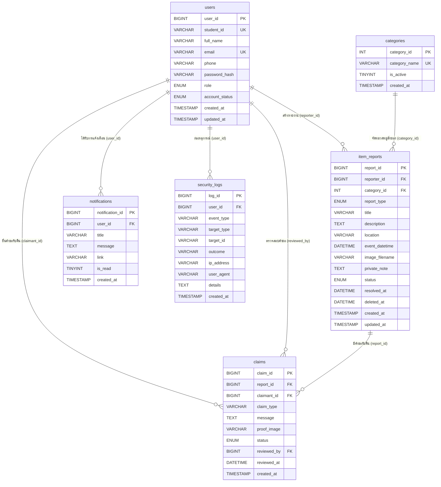

---

## 7. พจนานุกรมข้อมูล (Data Dictionary)

### 7.1 ตาราง `users` (ตารางข้อมูลผู้ใช้งาน)
| ชื่อฟิลด์ (Field) | ชนิดข้อมูล (Data Type) | Null | Key | ค่าเริ่มต้น (Default) | คำอธิบาย (Description) |
|---|---|:---:|:---:|:---:|---|
| `user_id` | BIGINT UNSIGNED | NO | PK | Auto Inc | รหัสประจำตัวผู้ใช้ (Primary Key) |
| `student_id` | VARCHAR(50) | NO | UNI | - | รหัสนักศึกษา / รหัสบุคลากร (รูปแบบ `xxxxxxxxx-x`) |
| `full_name` | VARCHAR(150) | NO | - | - | ชื่อและนามสกุลจริงของผู้ใช้งาน |
| `email` | VARCHAR(255) | NO | UNI | - | อีเมลสำหรับติดต่อและเข้าสู่ระบบ |
| `phone` | VARCHAR(30) | YES | - | NULL | เบอร์โทรศัพท์สำหรับประสานงานส่งมอบของ |
| `password_hash` | VARCHAR(255) | NO | - | - | รหัสผ่านที่ผ่านการแฮชด้วย BCRYPT |
| `role` | ENUM('student','staff','admin') | NO | IDX | 'student' | บทบาทและสิทธิ์การเข้าถึงระบบ |
| `account_status`| ENUM('active','inactive','suspended') | NO | IDX | 'active' | สถานะการใช้งานบัญชี |
| `created_at` | TIMESTAMP | NO | - | CURRENT_TIMESTAMP | วันเวลาที่สร้างบัญชี |
| `updated_at` | TIMESTAMP | NO | - | CURRENT_TIMESTAMP ON UPDATE | วันเวลาที่แก้ไขข้อมูลล่าสุด |

### 7.2 ตาราง `categories` (ตารางหมวดหมู่สิ่งของ)
| ชื่อฟิลด์ (Field) | ชนิดข้อมูล (Data Type) | Null | Key | ค่าเริ่มต้น (Default) | คำอธิบาย (Description) |
|---|---|:---:|:---:|:---:|---|
| `category_id` | INT UNSIGNED | NO | PK | Auto Inc | รหัสหมวดหมู่สิ่งของ |
| `category_name` | VARCHAR(100) | NO | UNI | - | ชื่อหมวดหมู่ (เช่น อุปกรณ์อิเล็กทรอนิกส์, เอกสาร/บัตร) |
| `is_active` | TINYINT(1) | NO | IDX | 1 | สถานะการเปิดใช้งาน (1=เปิด, 0=ปิด) |
| `created_at` | TIMESTAMP | NO | - | CURRENT_TIMESTAMP | วันเวลาที่สร้างหมวดหมู่ |

### 7.3 ตาราง `item_reports` (ตารางรายงานแจ้งของหายและพบของ)
| ชื่อฟิลด์ (Field) | ชนิดข้อมูล (Data Type) | Null | Key | ค่าเริ่มต้น (Default) | คำอธิบาย (Description) |
|---|---|:---:|:---:|:---:|---|
| `report_id` | BIGINT UNSIGNED | NO | PK | Auto Inc | รหัสรายงานสิ่งของ |
| `reporter_id` | BIGINT UNSIGNED | NO | FK | - | รหัสผู้ใช้ที่เป็นผู้แจ้ง (โยง `users.user_id`) |
| `category_id` | INT UNSIGNED | NO | FK | - | รหัสหมวดหมู่สิ่งของ (โยง `categories.category_id`) |
| `report_type` | ENUM('lost','found') | NO | IDX | - | ประเภทรายงาน: 'lost'=ของหาย, 'found'=พบของ |
| `title` | VARCHAR(255) | NO | - | - | ชื่อสิ่งของที่หายหรือพบ |
| `description` | TEXT | NO | - | - | รายละเอียด ลักษณะ สี และตำหนิของสิ่งของ |
| `location` | VARCHAR(255) | NO | - | - | สถานที่ที่ทำหายหรือพบสิ่งของ |
| `event_datetime`| DATETIME | NO | IDX | - | วันเวลาที่คาดว่าทำหายหรือพบสิ่งของ |
| `image_filename`| VARCHAR(255) | YES | - | NULL | ชื่อไฟล์ภาพที่ผ่านการสุ่มชื่อและจัดเก็บ |
| `private_note` | TEXT | YES | - | NULL | บันทึกส่วนตัวสำหรับผู้ดูแลระบบหรือผู้แจ้ง |
| `status` | ENUM('open','claimed','resolved','closed') | NO | IDX | 'open' | สถานะของสิ่งของ |
| `resolved_at` | DATETIME | YES | - | NULL | วันเวลาที่มีการส่งมอบคืนสำเร็จ |
| `deleted_at` | DATETIME | YES | IDX | NULL | วันเวลาที่ลบแบบ Soft Delete |
| `created_at` | TIMESTAMP | NO | - | CURRENT_TIMESTAMP | วันเวลาที่สร้างรายงาน |
| `updated_at` | TIMESTAMP | NO | - | CURRENT_TIMESTAMP ON UPDATE | วันเวลาที่แก้ไขรายงานล่าสุด |

### 7.4 ตาราง `claims` (ตารางคำขอรับคืนสิ่งของ)
| ชื่อฟิลด์ (Field) | ชนิดข้อมูล (Data Type) | Null | Key | ค่าเริ่มต้น (Default) | คำอธิบาย (Description) |
|---|---|:---:|:---:|:---:|---|
| `claim_id` | BIGINT UNSIGNED | NO | PK | Auto Inc | รหัสคำขอรับคืน |
| `report_id` | BIGINT UNSIGNED | NO | FK | - | รหัสรายงานสิ่งของที่ต้องการขอคืน (โยง `item_reports`) |
| `claimant_id` | BIGINT UNSIGNED | NO | FK | - | รหัสผู้ขอยื่นรับคืน (โยง `users.user_id`) |
| `claim_type` | VARCHAR(50) | NO | - | - | ประเภทการเคลม (เช่น 'owner_claim') |
| `message` | TEXT | NO | - | - | ข้อความอธิบายหลักฐานยืนยันความเป็นเจ้าของ |
| `proof_image` | VARCHAR(255) | YES | - | NULL | ชื่อไฟล์ภาพหลักฐานเพิ่มเติม |
| `status` | ENUM('pending','approved','rejected','cancelled') | NO | IDX | 'pending' | สถานะการตรวจสอบคำขอ |
| `reviewed_by` | BIGINT UNSIGNED | YES | FK | NULL | รหัสผู้ตรวจสอบ/ผู้อนุมัติคำขอ |
| `reviewed_at` | DATETIME | YES | - | NULL | วันเวลาที่ทำการอนุมัติหรือปฏิเสธคำขอ |
| `created_at` | TIMESTAMP | NO | - | CURRENT_TIMESTAMP | วันเวลาที่ยื่นคำขอ |

### 7.5 ตาราง `notifications` (ตารางการแจ้งเตือน)
| ชื่อฟิลด์ (Field) | ชนิดข้อมูล (Data Type) | Null | Key | ค่าเริ่มต้น (Default) | คำอธิบาย (Description) |
|---|---|:---:|:---:|:---:|---|
| `notification_id`| BIGINT UNSIGNED | NO | PK | Auto Inc | รหัสการแจ้งเตือน |
| `user_id` | BIGINT UNSIGNED | NO | FK | - | รหัสผู้ใช้ผู้รับการแจ้งเตือน (โยง `users`) |
| `title` | VARCHAR(255) | NO | - | - | หัวข้อการแจ้งเตือน |
| `message` | TEXT | NO | - | - | ข้อความรายละเอียด |
| `link` | VARCHAR(255) | YES | - | NULL | ลิงก์ URL ไปยังหน้ารายละเอียดที่เกี่ยวข้อง |
| `is_read` | TINYINT(1) | NO | IDX | 0 | สถานะการอ่าน (0=ยังไม่อ่าน, 1=อ่านแล้ว) |
| `created_at` | TIMESTAMP | NO | - | CURRENT_TIMESTAMP | วันเวลาที่ส่งการแจ้งเตือน |

### 7.6 ตาราง `security_logs` (ตารางบันทึกเหตุการณ์ความปลอดภัย)
| ชื่อฟิลด์ (Field) | ชนิดข้อมูล (Data Type) | Null | Key | ค่าเริ่มต้น (Default) | คำอธิบาย (Description) |
|---|---|:---:|:---:|:---:|---|
| `log_id` | BIGINT UNSIGNED | NO | PK | Auto Inc | รหัสบันทึกเหตุการณ์ |
| `user_id` | BIGINT UNSIGNED | YES | FK | NULL | รหัสผู้ใช้ที่เกี่ยวข้องกับเหตุการณ์ (ถ้ามี) |
| `event_type` | VARCHAR(100) | NO | IDX | - | ประเภทเหตุการณ์ (เช่น `login_success`, `login_failed`) |
| `target_type` | VARCHAR(100) | YES | - | NULL | ประเภทของเป้าหมาย (เช่น `report`, `claim`, `user`) |
| `target_id` | VARCHAR(100) | YES | - | NULL | รหัสของเป้าหมายที่เกิดการกระทำ |
| `outcome` | VARCHAR(50) | NO | - | - | ผลลัพธ์: 'success' หรือ 'failed' |
| `ip_address` | VARCHAR(45) | NO | - | - | หมายเลข IP Address ของ Client (IPv4/IPv6) |
| `user_agent` | VARCHAR(500) | YES | - | NULL | ข้อมูลเว็บเบราว์เซอร์และระบบปฏิบัติการ |
| `details` | TEXT | YES | - | NULL | รายละเอียดเพิ่มเติมในรูปแบบ JSON หรือข้อความ |
| `created_at` | TIMESTAMP | NO | IDX | CURRENT_TIMESTAMP | วันเวลาที่เกิดเหตุการณ์ |

---

## 8. หน้าจอการทำงานจริงพร้อมคำอธิบายภาพ

ในส่วนนี้แสดงภาพถ่ายหน้าจอจริงของระบบ (Real UI Screenshots) โดยเรนเดอร์ด้วยฟอนต์ **Prompt** แท้ ตรงตามหน้าเว็บจริง 100%:

---

### รูปที่ 8.1: หน้าหลักรายการสิ่งของ — แบบการ์ด (Card Grid View)
* **ตำแหน่ง URL:** `/reports/index.php`
* **คำอธิบายภาพ:** หน้ารายการสิ่งของสาธารณะในมุมมองแบบ Card Grid ที่ออกแบบให้ดูทันสมัย สะอาดตา และเป็นมิตรต่อผู้ใช้งาน มีช่องค้นหาแบบ Full-text, ปุ่มตัวกรอง "ทั้งหมด", "ของหาย", "พบสิ่งของ" และตัวกรองหมวดหมู่ บนการ์ดแต่ละใบแสดงภาพสิ่งของ, ป้ายประเภท (สีเขียว=พบสิ่งของ, สีแดง=ของหาย), วันเวลา, สถานที่ และปุ่มกด "ยื่นขอรับคืน" หรือ "ดูรายละเอียด"
* **การใช้งานจริง:** นักศึกษาที่ทำของหายหรือเก็บของได้ สามารถเปิดหน้านี้เพื่อเลื่อนดูรายการล่าสุดได้อย่างรวดเร็ว

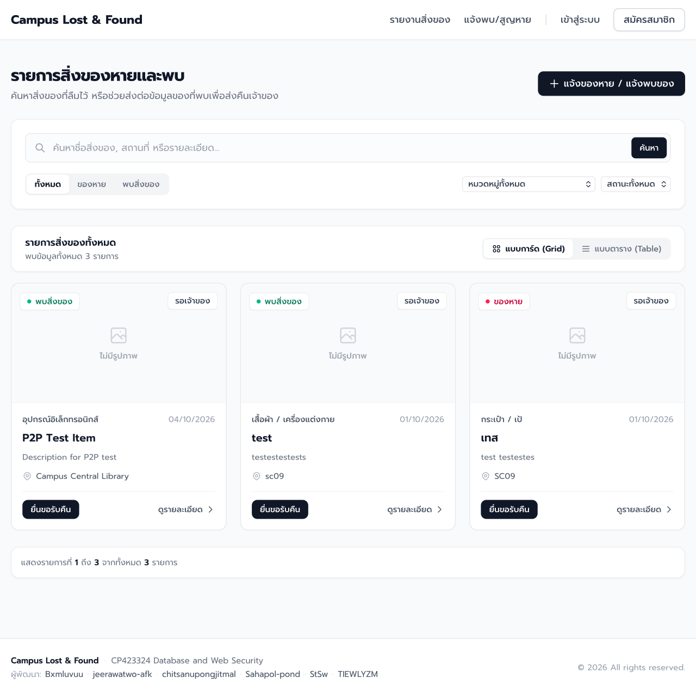

---

### รูปที่ 8.2: หน้าหลักรายการสิ่งของ — แบบตาราง (Table View)
* **ตำแหน่ง URL:** `/reports/index.php` (กดปุ่มสลับมุมมอง "แบบตาราง (Table)")
* **คำอธิบายภาพ:** สำหรับผู้ใช้ที่ต้องการเปรียบเทียบข้อมูลจำนวนมากในคราวเดียว สามารถกดปุ่ม **View Switcher** เพื่อเปลี่ยนเป็น Table View ได้ทันที ตารางแสดงคอลัมน์ประเภท, รูปย่อ Thumbnail, ชื่อสิ่งของ, หมวดหมู่, สถานที่, วันเวลาที่จัดรูปแบบเรียบร้อย (`d/m/Y H:i`), ป้ายสถานะ และปุ่มดำเนินการ
* **การใช้งานจริง:** ช่วยให้การกวาดสายตาหาของหายทำได้สะดวกรวดเร็วเมื่อมีข้อมูลสิ่งของจำนวนมาก

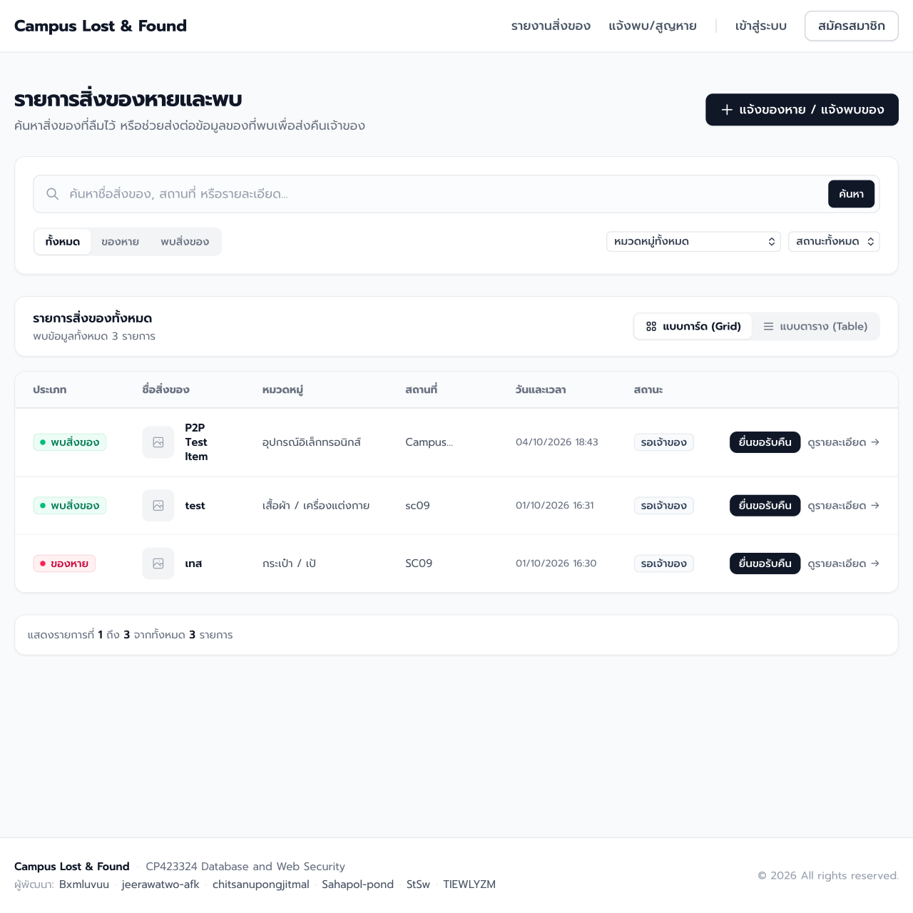

---

### รูปที่ 8.3: หน้าเข้าสู่ระบบ (Login Page)
* **ตำแหน่ง URL:** `/auth/login.php`
* **คำอธิบายภาพ:** ฟอร์มเข้าสู่ระบบที่ปลอดภัย รองรับการระบุทั้ง **อีเมลมหาวิทยาลัย** หรือ **รหัสนักศึกษา** พร้อมรหัสผ่าน ฟอร์มฝังระบบ CSRF Token แบบซ่อนไว้ และมีระบบ Rate Limiting ตรวจจับความพยายามล็อกอินซ้ำ หากกรอกรหัสผ่านผิดเกินกำหนด ระบบจะแสดงช่อง Math CAPTCHA ให้คำนวณตัวเลขเพื่อป้องกัน Brute-Force Bot
* **การใช้งานจริง:** เมื่อผู้ใช้กรอกข้อมูลถูกต้อง ระบบจะทำการ Re-generate Session ID ทันทีเพื่อความปลอดภัย

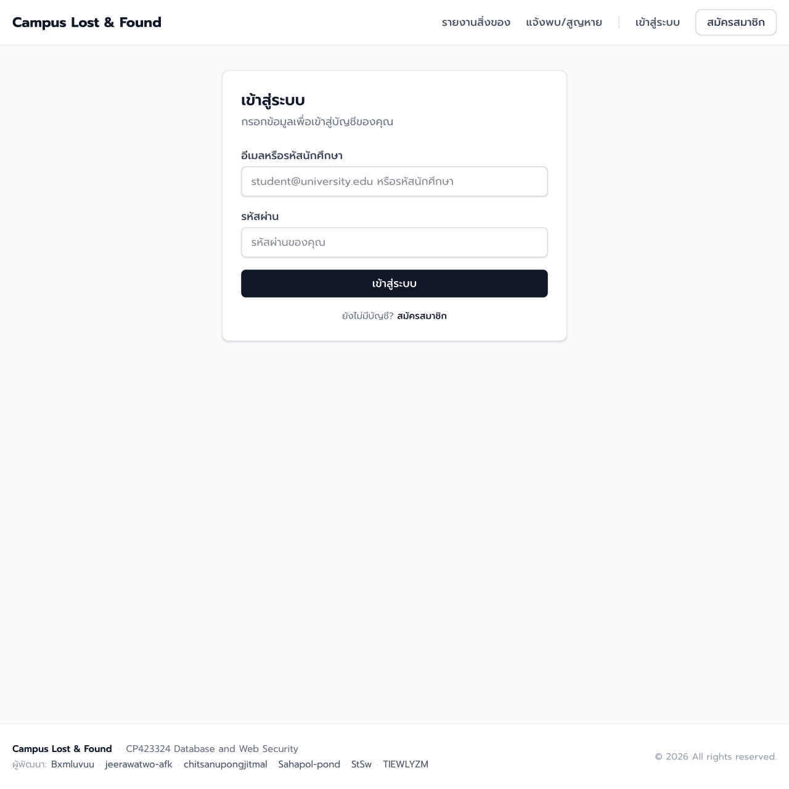

---

### รูปที่ 8.4: หน้าสมัครสมาชิกพร้อมหลอดวัดระดับความปลอดภัยรหัสผ่าน (Password Strength Meter)
* **ตำแหน่ง URL:** `/auth/register.php`
* **คำอธิบายภาพ:** หน้าจอสมัครสมาชิกพร้อม **Password Strength Meter & Checklist** แบบ Real-time ตัวอย่างแสดงการกรอกรหัสผ่านที่มีความปลอดภัยระดับสูง (`SecureP@ss2026`) โดยเปิดปุ่มรูปดวงตา (👁️) เพื่อแสดงรหัสผ่านให้เห็นอักขระชัดเจน หลอดวัดระดับความปลอดภัยแสดงแถบสีเขียวครบทั้ง 4 ส่วนระบุ "ปลอดภัยสูง (Strong)" พร้อมเครื่องหมายถูกสีเขียวผ่านเกณฑ์ความปลอดภัยครบทั้ง 4 ข้อ (ความยาวเกิน 8 ตัวอักษร, มีทั้งตัวพิมพ์เล็ก/ใหญ่, มีตัวเลข, มีอักขระพิเศษ) และช่องยืนยันรหัสผ่านตรงกันสมบูรณ์
* **การใช้งานจริง:** ช่วยแนะนำและบังคับให้นักศึกษาตั้งรหัสผ่านที่รัดกุมตั้งแต่ขั้นตอนการสร้างบัญชี ป้องกันการใช้รหัสผ่านที่คาดเดาได้ง่ายตามหลักเกณฑ์ความมั่นคงปลอดภัย

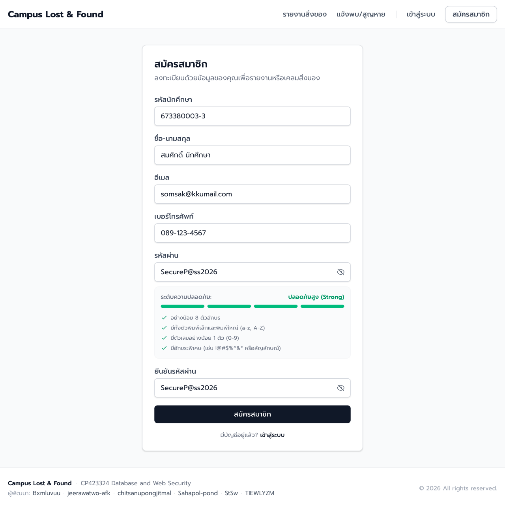

---

### รูปที่ 8.5: หน้าแจ้งของหาย / แจ้งพบสิ่งของ (Report Create Form)
* **ตำแหน่ง URL:** `/reports/create.php`
* **คำอธิบายภาพ:** ฟอร์มสำหรับให้นักศึกษาและบุคลากรบันทึกข้อมูลสิ่งของ มีตัวเลือกประเภทรายงาน (ของหาย / พบของ), ชื่อสิ่งของ, หมวดหมู่, วันเวลาที่เกิดเหตุ, สถานที่ในมหาวิทยาลัย, รายละเอียดลักษณะตำหนิ และจุดอัปโหลดรูปภาพที่ผ่านการตรวจสอบความปลอดภัยฝั่งเซิร์ฟเวอร์
* **การใช้งานจริง:** เมื่อกดบันทึก ข้อมูลจะถูกจัดเก็บลงตาราง `item_reports` ด้วย Prepared Statements 100%

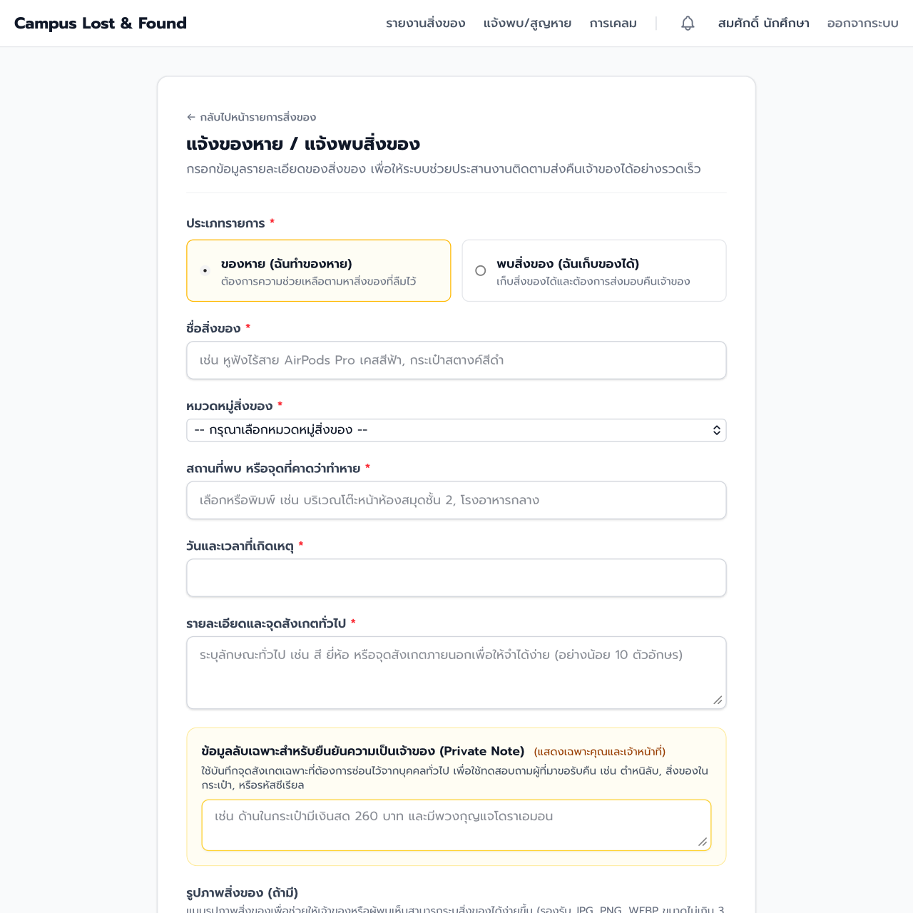

---

### รูปที่ 8.6: หน้ารายละเอียดสิ่งของและระบบส่งมอบคืนระดับชุมชน (Peer-to-Peer Community Handover)
* **ตำแหน่ง URL:** `/reports/show.php?id=3`
* **คำอธิบายภาพ:** หน้าจอแสดงข้อมูลสิ่งของอย่างละเอียด พร้อม **ฟังก์ชันเด่น Peer-to-Peer Handover**: สำหรับผู้ใช้ที่เป็นผู้พบสิ่งของ จะเห็นกล่องสีเขียวแสดงคำแนะนำการนัดหมาย พร้อมรายชื่อเพื่อนที่ยื่นขอรับคืน ช่องทางติดต่อ (เบอร์โทรและอีเมล) และ **ปุ่มสีเขียว "ยืนยันส่งมอบของให้คนนี้แล้ว"**
* **การใช้งานจริง:** ผู้พบของสามารถโทรนัดเจอกันตามพื้นที่ส่วนกลาง เมื่อตรวจหลักฐานต่อหน้าแล้ว สามารถกดปุ่มยืนยันส่งมอบในระบบได้ทันทีโดยไม่ต้องเดินทางไปหาเจ้าหน้าที่

> ภาพนี้ไม่ได้รวมในฉบับเผยแพร่สาธารณะ เนื่องจากมีข้อมูลระบุตัวบุคคลในระบบทดสอบ

---

### รูปที่ 8.7: หน้าจัดการคำขอรับคืนสิ่งของ (Claims Management)
* **ตำแหน่ง URL:** `/claims/index.php`
* **คำอธิบายภาพ:** หน้ารวมประวัติคำขอรับคืนของผู้ใช้งาน มีกล่องคำแนะนำ Community Handover สีเขียวด้านบน และแท็บแยก 2 ส่วน:
  1. *คำขอของฉัน (My Claims):* รายการคำขอที่ตนเองยื่นไปหาผู้อื่น พร้อมสถานะการตรวจสอบ
  2. *คำขอที่ได้รับ (Received Claims):* คำขอที่ผู้อื่นส่งมายังสิ่งของที่ตนเก็บได้
* **การใช้งานจริง:** ช่วยให้ติดตามความคืบหน้าของการนัดรับสิ่งของคืนได้อย่างเป็นระเบียบ

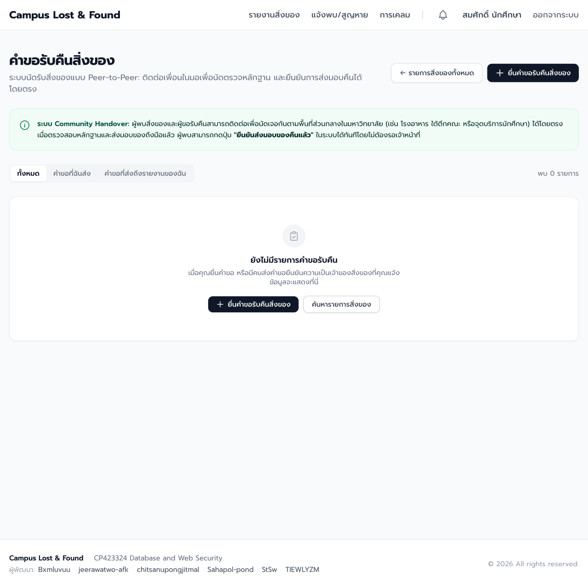

---

### รูปที่ 8.8: หน้าศูนย์การแจ้งเตือนส่วนบุคคล (Notification Center)
* **ตำแหน่ง URL:** `/notifications.php`
* **คำอธิบายภาพ:** หน้ารวมการแจ้งเตือนแบบ In-App Notifications มีป้ายแยกประเภทการแจ้งเตือนอย่างชัดเจน เช่น "คำขอรับคืน" (สีส้ม), "สถานะรายการ" (สีฟ้า), "ทั่วไป" (สีเทา) แสดงจุดวงกลมสีดำกำกับรายการที่ยังไม่ได้อ่าน พร้อมปุ่มกดยืนยันว่าอ่านแล้ว หรือกดลบการแจ้งเตือน
* **การใช้งานจริง:** เมื่อมีผู้ยื่นคำขอรับคืนหรือมีความคืบหน้า ระบบจะสร้างแจ้งเตือนมายังหน้านี้พร้อมแสดงตัวเลข Badge บนแถบ Navbar

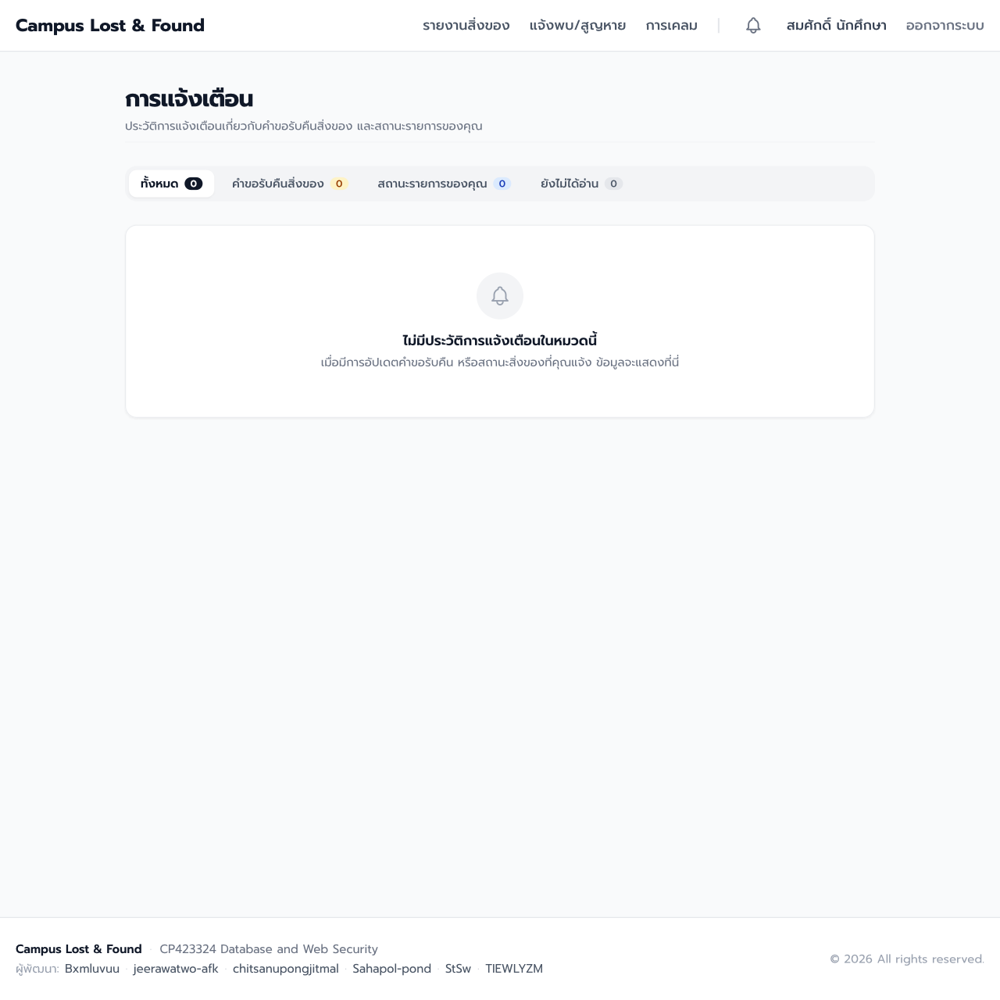

---

### รูปที่ 8.9: หน้าแดชบอร์ดภาพรวมระบบของผู้ดูแลระบบ (Admin Dashboard)
* **ตำแหน่ง URL:** `/admin/index.php`
* **คำอธิบายภาพ:** หน้าควบคุมหลักของผู้ดูแลระบบ แสดงการ์ดสถิติสำคัญ 4 ช่อง: จำนวนผู้ใช้ที่ลงทะเบียน, หมวดหมู่ที่เปิดใช้งาน, รายงานที่กำลังค้นหา, และคำขอรับคืนที่รอดำเนินการ พร้อมตารางแสดงรายงานสิ่งของล่าสุด, คำขอรับคืนล่าสุด และบันทึกความปลอดภัยล่าสุด (Recent Security Logs)
* **การใช้งานจริง:** ช่วยให้ผู้ดูแลระบบมองเห็นสถานะและกิจกรรมความปลอดภัยทั้งหมดในระบบได้ในหน้าจอเดียว

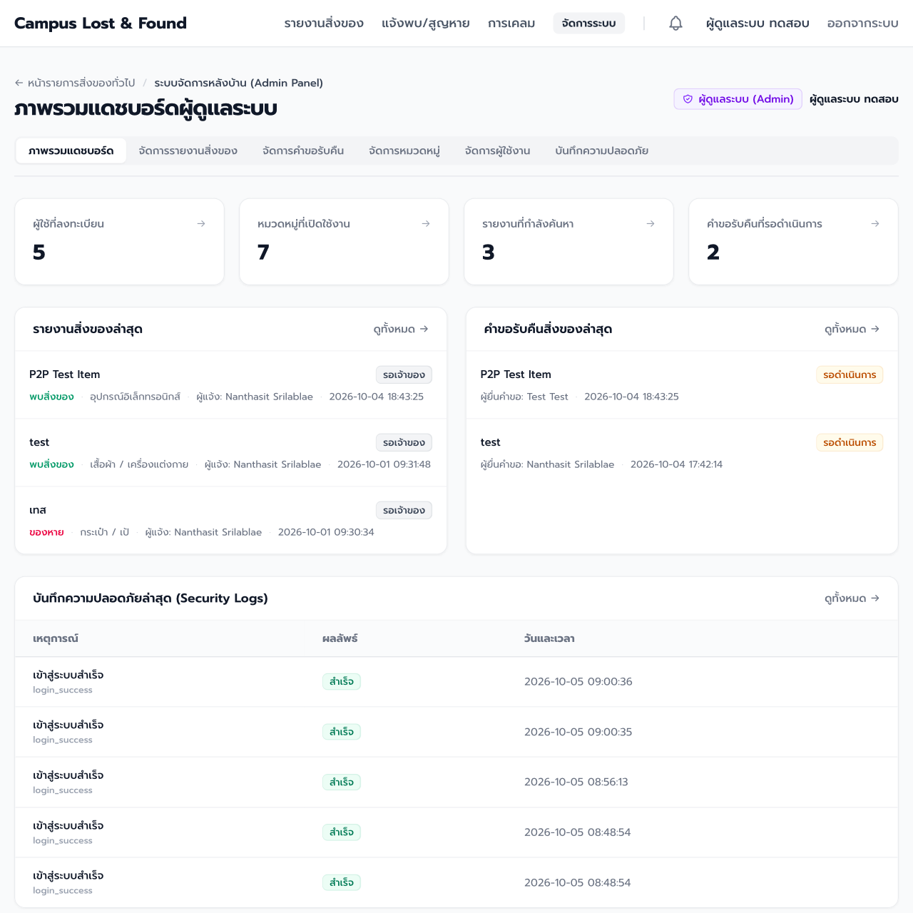

---

### รูปที่ 8.10: หน้าจัดการรายการสิ่งของของผู้ดูแลระบบ (Admin Reports Management)
* **ตำแหน่ง URL:** `/admin/reports.php`
* **คำอธิบายภาพ:** ตารางบริหารจัดการรายการสิ่งของทั้งหมดในระบบ มีตัวกรองค้นหา วันที่ และสถานะ ผู้ดูแลระบบสามารถคลิกปุ่ม **"จัดการ"** เพื่อเปิด Modal ปรับเปลี่ยนสถานะ (Open, Claimed, Resolved, Closed) หรือกดปุ่ม **"ลบ"** เพื่อเปิด Modal ยืนยันการลบแบบ Soft Delete ได้ทันทีโดยไม่ต้องโหลดหน้าใหม่ซ้ำซ้อน
* **การใช้งานจริง:** เพิ่มความสะดวกรวดเร็วในการบริหารจัดการข้อมูลสิ่งของจำนวนมาก

> ภาพนี้ไม่ได้รวมในฉบับเผยแพร่สาธารณะ เนื่องจากมีข้อมูลระบุตัวบุคคลในระบบทดสอบ

---

### รูปที่ 8.11: หน้าจัดการคำขอรับคืนของผู้ดูแลระบบ (Admin Claims Management)
* **ตำแหน่ง URL:** `/admin/claims.php`
* **คำอธิบายภาพ:** หน้าจอสำหรับเจ้าหน้าที่และผู้ดูแลระบบในการตรวจสอบคำขอรับคืนสิ่งของ แสดงผู้ยื่นคำขอ, สิ่งของที่ขอคืน, ข้อความหลักฐาน, วันเวลา และสถานะ สามารถกดเปิด Modal เพื่อพิจารณาอนุมัติ (Approved) หรือปฏิเสธ (Rejected) คำขอได้
* **การใช้งานจริง:** ใช้สำหรับกรณีที่มีการส่งมอบของผ่านศูนย์กลาง หรือช่วยไกล่เกลี่ยข้อพิพาทเมื่อมีผู้ขอรับคืนหลายคน

> ภาพนี้ไม่ได้รวมในฉบับเผยแพร่สาธารณะ เนื่องจากมีข้อมูลระบุตัวบุคคลในระบบทดสอบ

---

### รูปที่ 8.12: หน้าจัดการผู้ใช้งาน (Admin User Management)
* **ตำแหน่ง URL:** `/admin/users.php`
* **คำอธิบายภาพ:** ตารางจัดการบัญชีผู้ใช้งานทั้งหมด แสดงรหัสนักศึกษา, ชื่อ-นามสกุล, อีเมล, บทบาท (Badge สีม่วง=Admin, สีฟ้า=Staff, สีเทา=Student) และสถานะบัญชี (Active, Suspended, Inactive) พร้อมปุ่มแก้ไขที่เปิด Modal รวมศูนย์ให้ปรับเปลี่ยน Role หรือระงับบัญชีผู้ใช้ได้ทันที
* **การใช้งานจริง:** ใช้ระงับบัญชีผู้ใช้งานที่ทำผิดกฎหรือโพสต์ข้อมูลเท็จ

> ภาพนี้ไม่ได้รวมในฉบับเผยแพร่สาธารณะ เนื่องจากมีข้อมูลระบุตัวบุคคลในระบบทดสอบ

---

### รูปที่ 8.13: หน้าจัดการหมวดหมู่สิ่งของ (Admin Category Management)
* **ตำแหน่ง URL:** `/admin/categories.php`
* **คำอธิบายภาพ:** หน้าจอเพิ่ม แก้ไข และเปิด/ปิดสถานะหมวดหมู่สิ่งของ (เช่น อุปกรณ์อิเล็กทรอนิกส์, เสื้อผ้า, กระเป๋า, กุญแจ) ตารางแสดงสถานะเปิดใช้งานด้วยสวิตช์ Toggle พร้อมปุ่มแก้ไขชื่อหมวดหมู่ผ่าน Modal
* **การใช้งานจริง:** ผู้ดูแลระบบสามารถเพิ่มหมวดหมู่ใหม่ๆ ให้สอดคล้องกับพฤติกรรมการทำของหายของนักศึกษาได้ตลอดเวลา

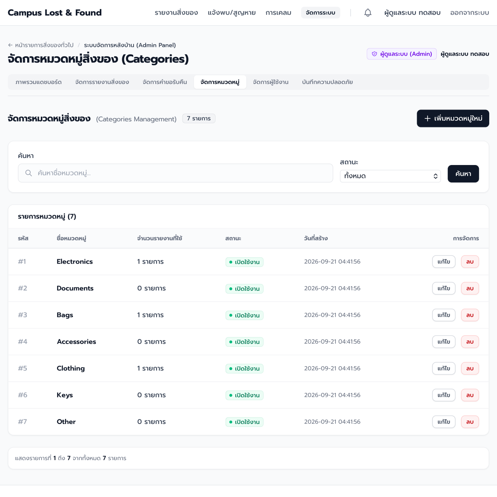

---

### รูปที่ 8.14: หน้าตรวจสอบและส่งออก Security Audit Logs (Admin Security Logs & CSV Export)
* **ตำแหน่ง URL:** `/admin/logs.php`
* **คำอธิบายภาพ:** หน้าจอแสดงประวัติความปลอดภัย (Security Audit Trail) ทั้งหมดของระบบ แสดงรหัส Log, วันเวลา, ประเภทเหตุการณ์ (`login_success`, `login_failed`, `unauthorized_access`), ผลลัพธ์, รหัสผู้ใช้, IP Address ของ Client และรายละเอียด พร้อมปุ่มสำคัญทางขวาบน **"ส่งออก Security Logs (CSV)"**
* **การใช้งานจริง:** เป็นเครื่องมือสำคัญสำหรับผู้ดูแลระบบในการสืบสวนเหตุการณ์ผิดปกติ (Forensic Investigation) และใช้ดาวน์โหลดรายงานไปส่งอาจารย์หรือผู้บริหาร

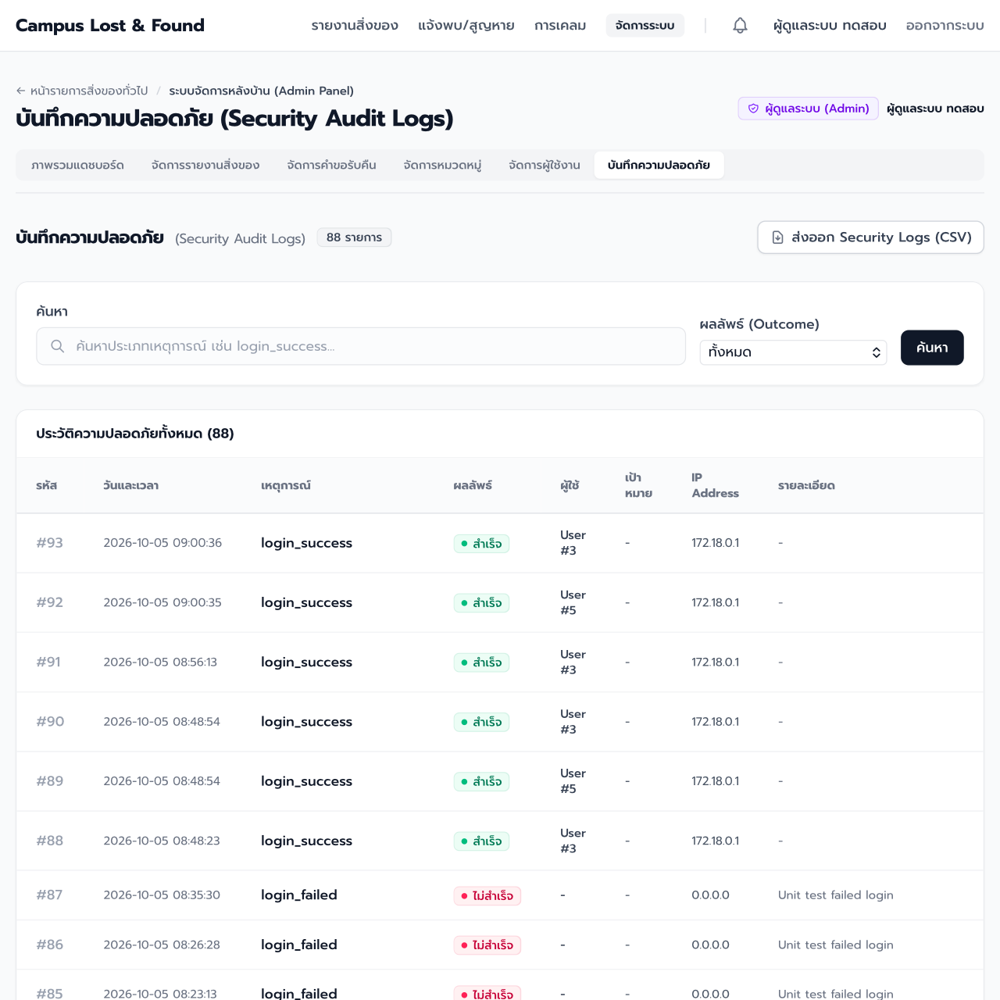

---

## 9. การประยุกต์ใช้มาตรการความมั่นคงปลอดภัย

ในส่วนนี้แสดงภาพการ์ดโค้ดจริง (Code Cards) จากระบบ พร้อมการอธิบายการทำงานในเชิงลึก ครบทั้ง 10 ด้านตามข้อกำหนดของวิชา CP423324:

---

### รูปที่ 9.1: ด้านการป้องกัน SQL Injection ด้วย Prepared Statements 100%
* **ตำแหน่งไฟล์:** [`app/reports/report_data.php`](file:///Users/Bxmluvuu/Project/CP423324/app/reports/report_data.php)
* **หลักการทำงาน:**
  1. คำสั่ง SQL ถูกแยกออกจากข้อมูลดิบของผู้ใช้อย่างเด็ดขาด โดยส่งโครงสร้างคำสั่งไปยัง MariaDB Compiler ล่วงหน้าผ่าน `$database->prepare()`
  2. ข้อมูลจากผู้ใช้ถูกส่งผ่าน `$stmt->bind_param()` โดยระบุประเภทข้อมูลชัดเจน (`i` = integer, `s` = string)
  3. ระบบทำการ `$stmt->execute()` ทำให้แม้ผู้ใช้จะพยายามกรอกข้อความที่เป็น SQL Injection เช่น `' OR 1=1 --` ฐานข้อมูลจะมองเป็นเพียงข้อความ Literal String ธรรมดา ไม่สามารถเปลี่ยนแปลงตรรกะของคำสั่ง SQL ได้อย่างสิ้นเชิง

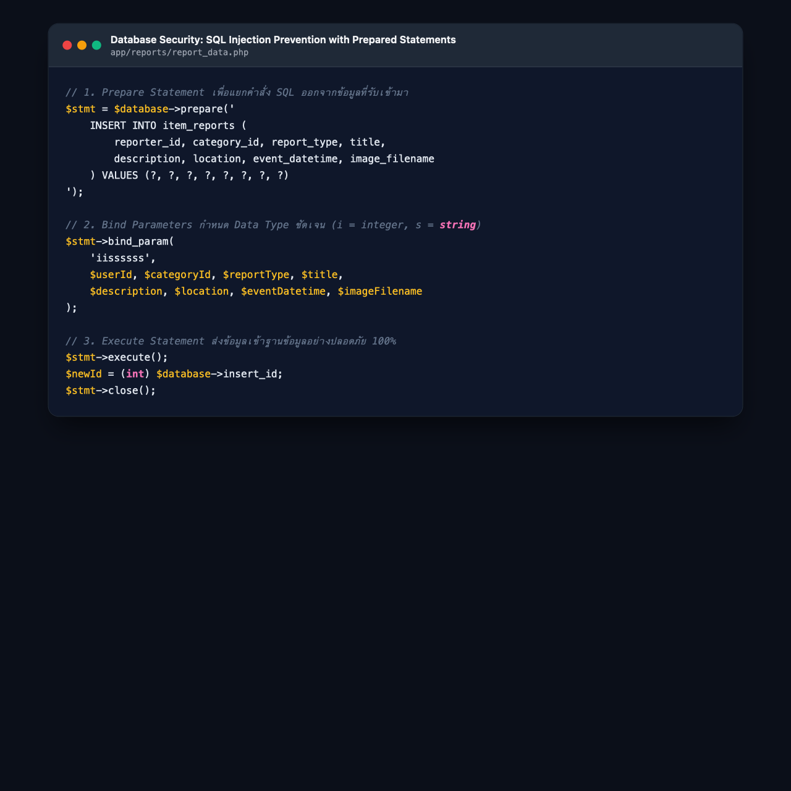

---

### รูปที่ 9.2: ด้าน Authentication & Password Security (BCRYPT Hashing)
* **ตำแหน่งไฟล์:** [`app/helpers/security.php`](file:///Users/Bxmluvuu/Project/CP423324/app/helpers/security.php)
* **หลักการทำงาน:**
  1. รหัสผ่านของผู้ใช้จะไม่ถูกเก็บในรูปแบบ Plaintext ในฐานข้อมูลโดยเด็ดขาด
  2. ใช้ฟังก์ชัน `password_hash($password, PASSWORD_BCRYPT, ['cost' => 12])` ซึ่งมีคุณสมบัติ:
     * มีการสร้าง Cryptographic Salt แบบสุ่มในตัว ป้องกันการโจมตีด้วย Rainbow Table
     * กำหนด Cost Factor เท่ากับ 12 ทำให้การคำนวณใช้เวลาที่เหมาะสม ชะลอความเร็วการแฮกด้วย Brute-Force หรือ GPU Cracking
  3. การตรวจสอบรหัสผ่านตอนล็อกอินใช้ `password_verify($password, $hash)` ซึ่งเปรียบเทียบในลักษณะ Constant-time ป้องกัน Timing Attack

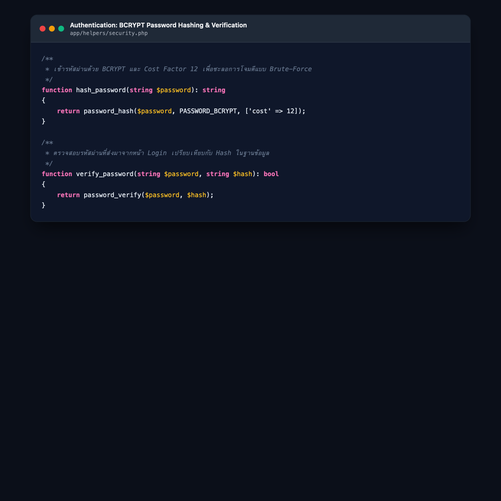

---

### รูปที่ 9.3: ด้าน Session Security & Cookie Hardening
* **ตำแหน่งไฟล์:** [`app/bootstrap.php`](file:///Users/Bxmluvuu/Project/CP423324/app/bootstrap.php) & [`app/helpers/auth.php`](file:///Users/Bxmluvuu/Project/CP423324/app/helpers/auth.php)
* **หลักการทำงาน:**
  1. **Session Cookie Hardening:** ตั้งค่าผ่าน `session_set_cookie_params()`:
     * `httponly = true`: ห้ามสคริปต์ JavaScript ในหน้าเว็บเข้าถึงคุกกี้เซสชัน ป้องกันการขโมย Session ผ่านช่องโหว่ XSS (Cookie Theft)
     * `samesite = 'Lax'`: ป้องกันเบราว์เซอร์ส่งคุกกี้เซสชันไปกับคำขอข้ามเว็บไซต์ ป้องกันการโจมตีแบบ CSRF
     * `secure = true` (บน Production): บังคับส่งคุกกี้ผ่านโปรโตคอลเข้ารหัส HTTPS เท่านั้น
  2. **Session Hijacking Prevention:** เมื่อผู้ใช้ล็อกอินสำเร็จ ระบบจะรัน `session_regenerate_id(true)` ทันทีเพื่อยกเลิก Session ID เดิม ป้องกันการโจมตีแบบ Session Fixation
  3. **Dual Session Timeout:** มีระบบตัดเซสชันทั้ง Idle Timeout (15 นาทีไม่มีกิจกรรม) และ Absolute Timeout (เซสชันหมดอายุสูงสุด 4 ชั่วโมง)

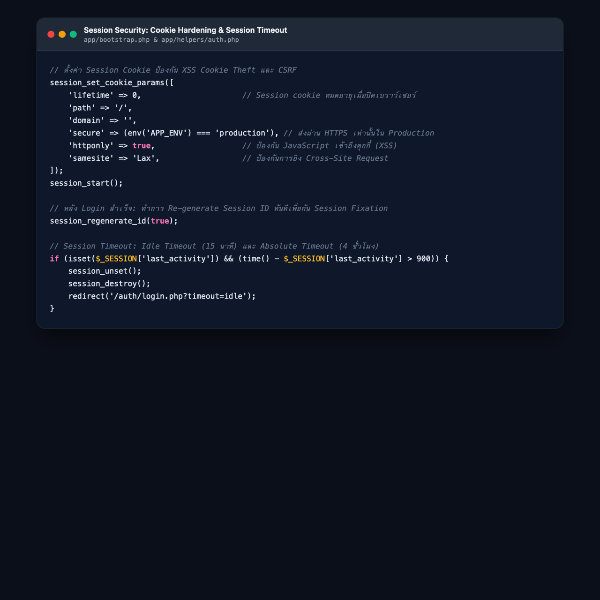

---

### รูปที่ 9.4: ด้านการป้องกัน Cross-Site Request Forgery (CSRF Protection)
* **ตำแหน่งไฟล์:** [`app/helpers/security.php`](file:///Users/Bxmluvuu/Project/CP423324/app/helpers/security.php)
* **หลักการทำงาน:**
  1. ฟังก์ชัน `generate_csrf_token()` สร้างโทเค็นสุ่มขนาด 64 ตัวอักษรฐานสิบหก (จาก 32 Cryptographically Secure Random Bytes) และเก็บไว้ใน Session ของผู้ใช้
  2. ฟังก์ชัน `csrf_field()` ฝังโทเค็นลงในฟอร์ม POST ทุกฟอร์ม
  3. เมื่อมีคำขอ POST ส่งกลับมา ฟังก์ชัน `verify_csrf_token()` จะเปรียบเทียบค่าที่ส่งมากับค่าใน Session โดยใช้ `hash_equals()` เพื่อป้องกันการโจมตีแบบ Timing Attack หากไม่ตรงกัน ระบบจะปฏิเสธคำขอ (HTTP 403 Forbidden) และบันทึกลง Security Logs ทันที

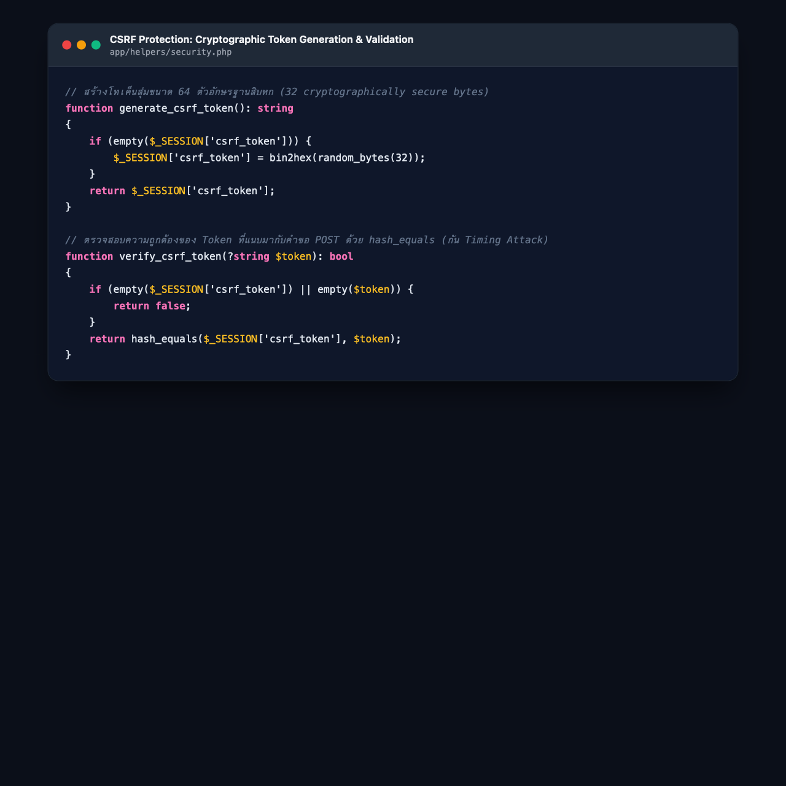

---

### รูปที่ 9.5: ด้านการป้องกัน Cross-Site Scripting (XSS Prevention)
* **ตำแหน่งไฟล์:** [`app/helpers/functions.php`](file:///Users/Bxmluvuu/Project/CP423324/app/helpers/functions.php)
* **หลักการทำงาน:**
  1. สร้างฟังก์ชัน Helper สั้น `e(?string $value): string` ทำหน้าที่เป็นจุดศูนย์กลางในการเข้ารหัสข้อมูล (Output Encoding)
  2. ภายในเรียกใช้ `htmlspecialchars($value, ENT_QUOTES, 'UTF-8')` ซึ่งจะแปลงอักขระพิเศษทาง HTML ทั้งหมด เช่น `<`, `>`, `&`, `"`, และ `'` ให้กลายเป็น HTML Entities (เช่น `&lt;script&gt;`)
  3. ทำให้โค้ด JavaScript ที่ผู้ไม่หวังดีพยายามฝังเข้ามาผ่านช่องค้นหา หรือชื่อสิ่งของ จะถูกแสดงผลเป็นเพียงข้อความธรรมดาบนหน้าจอ ไม่สามารถถูกเบราว์เซอร์สั่งรันเป็นโค้ดอันตรายได้

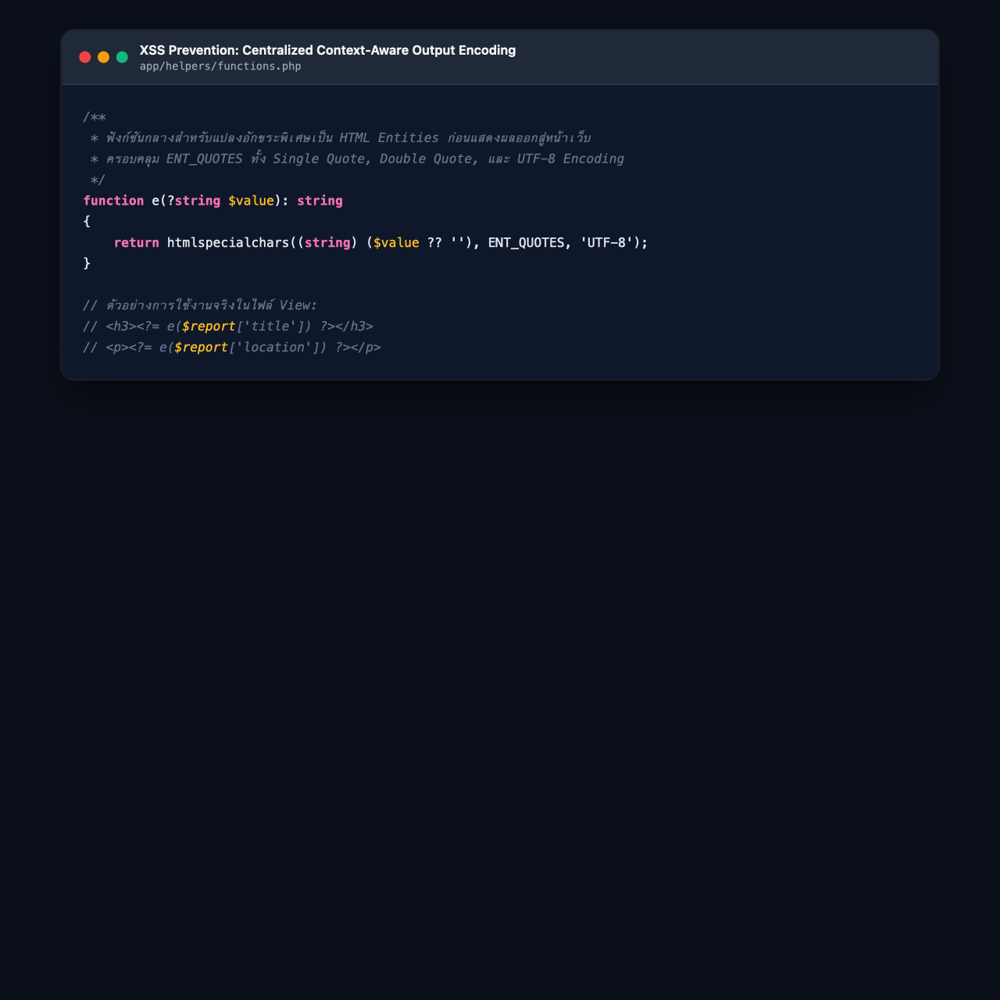

---

### รูปที่ 9.6: ด้านความปลอดภัยในการอัปโหลดไฟล์ (Secure File Upload)
* **ตำแหน่งไฟล์:** [`app/helpers/file_upload.php`](file:///Users/Bxmluvuu/Project/CP423324/app/helpers/file_upload.php)
* **หลักการทำงาน:**
  1. **สกัด Double Extension:** ตรวจจับชื่อไฟล์อันตรายที่มีนามสกุลซ้อน เช่น `shell.php.jpg` หรือ `exploit.phtml`
  2. **Extension Whitelist:** ตรวจสอบนามสกุลไฟล์อย่างเข้มงวด โดยอนุญาตเฉพาะ `jpg`, `jpeg`, `png`, และ `webp` เท่านั้น
  3. **MIME Type Validation:** ตรวจสอบ Magic Bytes หรือชนิดเนื้อหาไบนารีที่แท้จริงของไฟล์ผ่าน PHP `finfo` (ไม่เชื่อถือค่า Content-Type ที่ Client ส่งมา)
  4. **สุ่มชื่อไฟล์ใหม่:** สุ่มชื่อไฟล์ใหม่ด้วย `bin2hex(random_bytes(16)) . '.' . $ext` ป้องกัน Directory Traversal และการทับซ้อนของไฟล์
  5. **จำกัดขนาดไฟล์:** กำหนดขนาดสูงสุดไม่เกิน 5 MB

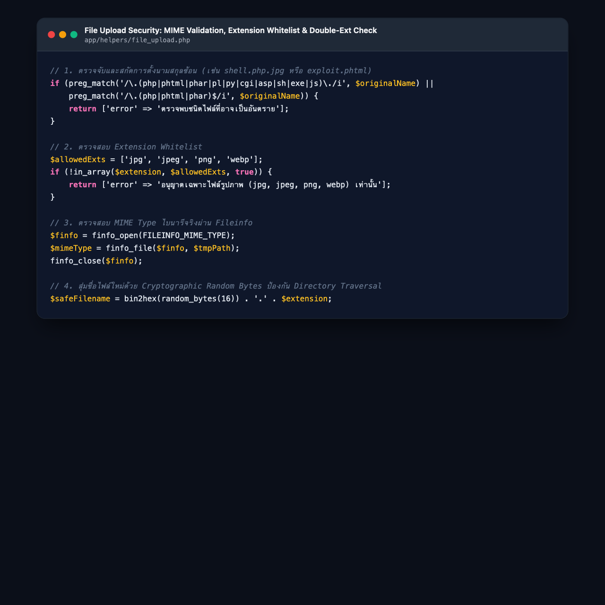

---

### รูปที่ 9.7: ด้าน Authorization & Role-Based Access Control (RBAC)
* **ตำแหน่งไฟล์:** [`app/helpers/auth.php`](file:///Users/Bxmluvuu/Project/CP423324/app/helpers/auth.php) & [`public/reports/edit.php`](file:///Users/Bxmluvuu/Project/CP423324/public/reports/edit.php)
* **หลักการทำงาน:**
  1. มีฟังก์ชัน `require_auth_role('admin')` ตรวจสอบระดับบทบาทก่อนเข้าถึงหน้าจัดการหลังบ้าน
  2. **Ownership Verification (สิทธิ์ความเป็นเจ้าของ):** ในหน้าแก้ไขหรือลบรายงาน ระบบจะตรวจสอบว่า `reporter_id` ของสิ่งของชิ้นนั้นต้องตรงกับ `user_id` ของผู้ใช้ที่กำลังล็อกอินอยู่เท่านั้น หากเป็นของคนอื่นและผู้ใช้ไม่ได้มีสิทธิ์ Admin ระบบจะตัดการทำงาน (HTTP 403) และบันทึกเหตุการณ์ `unauthorized_access` ทันที

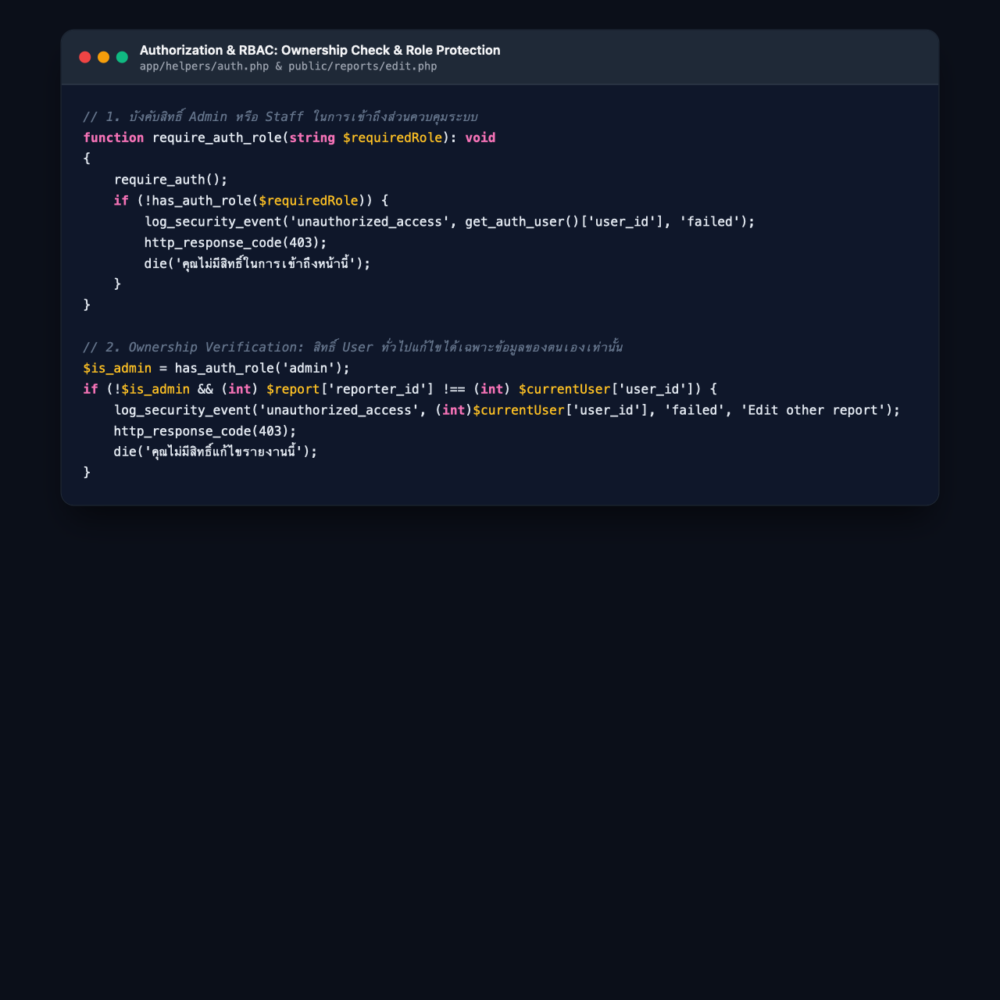

---

### รูปที่ 9.8: ด้านระบบบันทึกความปลอดภัย (Immutable Security Audit Logging)
* **ตำแหน่งไฟล์:** [`app/helpers/security.php`](file:///Users/Bxmluvuu/Project/CP423324/app/helpers/security.php)
* **หลักการทำงาน:**
  1. ฟังก์ชัน `log_security_event()` บันทึกทุกเหตุการณ์สำคัญ เช่น การล็อกอินสำเร็จ, ล็อกอินล้มเหลว, การพยายามเข้าถึงหน้าต้องห้าม, การส่งมอบของคืน, และการอัปโหลดไฟล์
  2. ทำการค้นหา IP Address ที่แท้จริงของผู้ใช้ผ่าน `get_client_ip()` โดยรองรับทั้ง Reverse Proxy, Docker Gateway และ CDN/Cloudflare
  3. บันทึก User Agent และรายละเอียดเพิ่มเติมในรูปแบบ JSON ลงตาราง `security_logs`
  4. **Immutable Design:** ตาราง Logs ไม่มีฟังก์ชันการแก้ไข (Update) หรือลบ (Delete) ออกแบบให้เก็บรักษาข้อมูลไว้เป็นหลักฐานทางนิติวิทยาศาสตร์ดิจิทัลอย่างสมบูรณ์

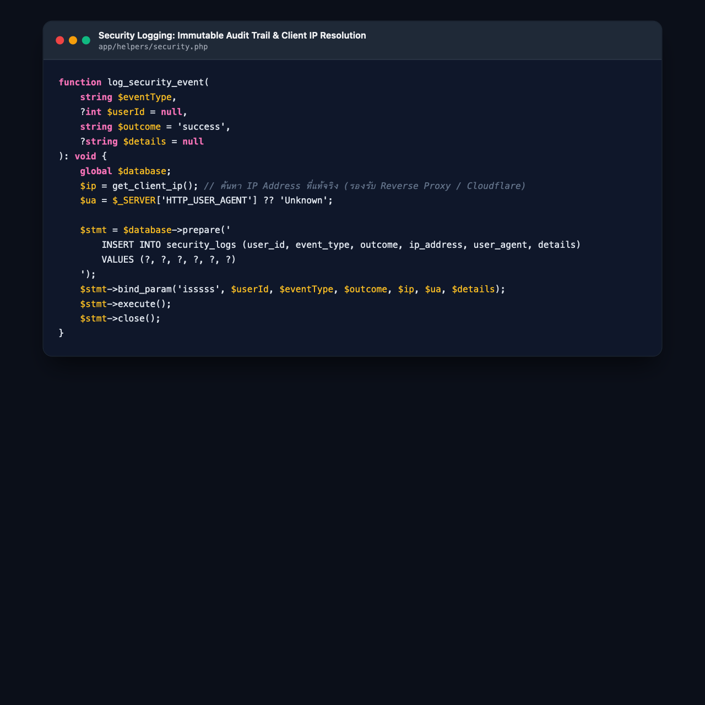

---

### รูปที่ 9.9: ด้านระบบจับคู่อัจฉริยะ (Smart Matching Recommendation Engine)
* **ตำแหน่งไฟล์:** [`app/services/smart_matching.php`](file:///Users/Bxmluvuu/Project/CP423324/app/services/smart_matching.php)
* **หลักการทำงาน:**
  1. วิเคราะห์ตัดคำภาษาไทยจากชื่อสิ่งของ สถานที่ และรายละเอียด
  2. นำรายงานของหายมาเปรียบเทียบกับรายการพบของ โดยให้คะแนนแบบ Multi-Factor: หมวดหมู่ตรงกัน (+40), วันเวลาใกล้เคียงกัน (+20), คีย์เวิร์ดและสถานที่ตรงกัน (+20 ถึง +40)
  3. คำนวณเป็นเปอร์เซ็นต์ Match Score เพื่อแสดงกล่องแนะนำสิ่งของที่คาดว่าเป็นชิ้นเดียวกันในหน้ารายละเอียดสิ่งของโดยอัตโนมัติ

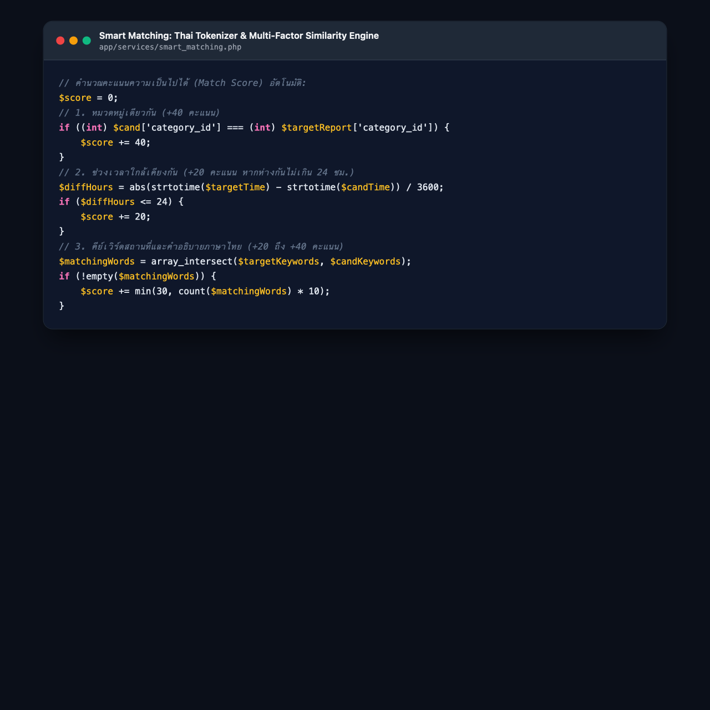

---

## 10. สรุปผลการทดสอบระบบ

ระบบได้รับการทดสอบความถูกต้องและความมั่นคงปลอดภัยด้วยชุดทดสอบอัตโนมัติ (Automated Security & Unit Test Suite) ในไฟล์ [`tests/run.php`](file:///Users/Bxmluvuu/Project/CP423324/tests/run.php) รวมทั้งสิ้น **77 รายการทดสอบ (77 Tests)** ผลการทดสอบผ่านทั้งหมด 100%:

```
======================================================
 Campus Lost & Found System - Automated Test Suite
 Course: CP423324 Database and Web Security
======================================================

--- 1. CSRF Protection & Token Security ---
[PASS] CSRF Token is 64 hex characters
[PASS] CSRF Token verification succeeds for matching token
[PASS] CSRF Token verification rejects null token
[PASS] CSRF Token verification rejects incorrect token
[PASS] CSRF Token verification rejects empty string

--- 2. XSS Escaping & Input Sanitization ---
[PASS] XSS script tags are escaped
[PASS] XSS quotes are escaped
[PASS] Valid email accepted
[PASS] Invalid email rejected
[PASS] Valid KKU student ID format accepted
[PASS] Invalid student ID rejected
[PASS] Valid phone accepted
[PASS] Invalid phone rejected
[PASS] Password minimum length enforced
[PASS] Valid password accepted

--- 3. File Upload Security Filters ---
[PASS] Malicious file name detected: shell.php.jpg
[PASS] Malicious file name detected: exploit.php
[PASS] Malicious file name detected: backdoor.phtml
[PASS] Malicious file name detected: script.phar.png

--- 4. Role-Based Access Control (RBAC) ---
[PASS] Admin role label is correct
[PASS] Staff role label is correct
[PASS] Student role label is correct
[PASS] Admin check matches role
[PASS] Staff check matches role
[PASS] Student is neither admin nor staff
[PASS] Admin badge uses sophisticated violet palette
[PASS] Staff badge uses cohesive sky palette
[PASS] Student badge uses balanced slate palette
[PASS] Role badge supports bilingual label display

--- 5. Smart Matching Keyword & Similarity Logic ---
[PASS] Extract meaningful words from Thai text
[PASS] Smart matching executes without database error

--- 6. Notification System ---
[PASS] Notification creation succeeds
[PASS] Unread notification count is positive
[PASS] Total notification count is positive
[PASS] Fetch notifications with pagination page 1 returns array
[PASS] Fetch notifications with pagination offset returns array
[PASS] Delete notification succeeds

--- 7. Audit Trail Immutability ---
[PASS] Audit logs remain immutable (no physical deletion)

--- 8. Category CRUD & Admin View ---
[PASS] Categories listing retrieves categories
[PASS] Category name < 2 characters rejected
[PASS] Category name > 100 characters rejected
[PASS] Category creation succeeds
[PASS] Duplicate category name detected and prevented
[PASS] Category update / rename succeeds
[PASS] Category reflects updated values (name & inactive)
[PASS] Category active status toggle succeeds
[PASS] Category deletion succeeds for unlinked category
[PASS] Admin categories view renders edit-category-modal
[PASS] Admin categories view renders edit buttons with data attributes
[PASS] Admin categories view removes redundant inline toggle forms from table

--- 9. User Form Consolidation & Security ---
[PASS] Temporary user created for form test
[PASS] Single form updates profile, role, and account status
[PASS] User record reflects updated role and status
[PASS] Temporary user cleanup succeeds
[PASS] Admin users view renders edit modal with role & status fields
[PASS] Admin users view removes redundant inline role forms from table
[PASS] Admin users view renders clean role badges
[PASS] Admin users view edit buttons have data attributes for form opening

--- 10. Unified Back-Office Architecture & UI Consistency ---
[PASS] Admin reports view renders persistent edit-report-modal
[PASS] Admin reports view edit buttons use data-attributes for client-side modal
[PASS] Admin reports view removes redundant inline status dropdown forms from table
[PASS] Admin reports view includes shared delete modal
[PASS] Admin claims view renders edit-claim-modal with status dropdown
[PASS] Admin claims view edit buttons use data-attributes for client-side modal
[PASS] Admin claims view removes redundant inline status dropdown forms from table
[PASS] Admin claims view includes shared delete modal

--- 11. Peer-to-Peer Claim & Handover Community Ecosystem ---
[PASS] reports_find includes reporter contact fields (email, phone, student_id)
[PASS] Claims view renders community handover banner
[PASS] Claims view uses peer-to-peer status labels
[PASS] Claims view renders direct handover confirmation action
[PASS] Report show view displays peer-to-peer claims & handover section to reporter
[PASS] Report show view displays direct handover confirmation button to reporter
[PASS] Reporter is recognized with authorization to confirm handover directly without admin
[PASS] P2P test data cleaned up successfully
[PASS] Reports view renders Card Grid container as default
[PASS] Reports view includes interactive View Mode Switcher
[PASS] Reports view cards display category icons and badges

======================================================
 Test Results: Total: 77 | Passed: 77 | Failed: 0
======================================================
```

---

## 11. ข้อเสนอแนะและแนวทางการพัฒนาต่อในอนาคต

เพื่อให้ระบบสามารถขยายขนาด (Scale) รองรับการใช้งานจริงของมหาวิทยาลัยขอนแก่นได้อย่างครอบคลุม ทีมงานขอเสนอแนวทางการพัฒนาต่อในอนาคต 5 ด้านดังนี้:

1. **การผสานระบบแจ้งเตือนผ่าน LINE Official Account (LINE Messaging API):**
   เชื่อมต่อการแจ้งเตือนเข้าสมาร์ตโฟนผ่าน LINE ทันทีที่มีผู้พบของที่คาดว่าเป็นของตนเอง หรือเมื่อมีผู้ขอรับของคืน ช่วยให้นักศึกษาไม่ต้องคอยเปิดเช็คหน้าเว็บตลอดเวลา
2. **การผสานระบบแผนที่พิกัด 3 มิติในมหาวิทยาลัย (Interactive Campus Map):**
   แสดงตำแหน่งที่พบและทำของหายบนแผนที่ดิจิทัลของมหาวิทยาลัยขอนแก่น พร้อมวิเคราะห์ Heatmap บริเวณที่เกิดเหตุบ่อย เช่น โรงอาหารคอมเพล็กซ์ หอสมุดกลาง หรือป้ายรถชัทเทิลบัส
3. **การประยุกต์ใช้ AI / Computer Vision เปรียบเทียบรูปภาพ:**
   ใช้โมเดล Image Embedding เปรียบเทียบความเหมือนของรูปถ่ายสิ่งของที่ทำหายกับสิ่งของที่พบโดยอัตโนมัติ เพื่อแก้ปัญหาการตั้งชื่อสิ่งของไม่ตรงกัน (เช่น ผู้พบพิมพ์ว่า "โทรศัพท์ผลไม้สีดำ" แต่เจ้าของพิมพ์ว่า "iPhone 14 Pro Space Black")
4. **การเชื่อมต่อ Single Sign-On (KKU Mail / Google Workspace SSO):**
   เปิดให้นักศึกษาล็อกอินด้วยบัญชี `@kkumail.com` ได้โดยตรงผ่าน OAuth2 / OpenID Connect ช่วยยืนยันสถานะการเป็นนักศึกษาปัจจุบันแบบ Real-time และลดขั้นตอนการสมัครสมาชิก
5. **ระบบ QR Code Labeling สำหรับศูนย์รับฝากของกลาง:**
   พิมพ์สติกเกอร์ QR Code ติดบนถุงเก็บของ เพื่อให้เจ้าหน้าที่สแกนบันทึกสถานะการเก็บเข้าตู้/ชั้นวางได้อย่างเป็นระบบ และสามารถสแกนเพื่อตรวจสอบประวัติได้อย่างรวดเร็ว

---

**สรุปภาพรวม:** โครงงาน Campus Lost & Found System ได้รับการพัฒนาขึ้นอย่างประณีต ครบถ้วนตามข้อกำหนดทุกข้อของรายวิชา CP423324 มีเอกสารประกอบครบถ้วน มีการใช้งานจริงที่แก้ปัญหาของนักศึกษาได้อย่างเป็นรูปธรรม และมีความมั่นคงปลอดภัยตามมาตรฐานสากล พร้อมสำหรับการนำเสนอและส่งมอบงานเพื่อประเมินผล
